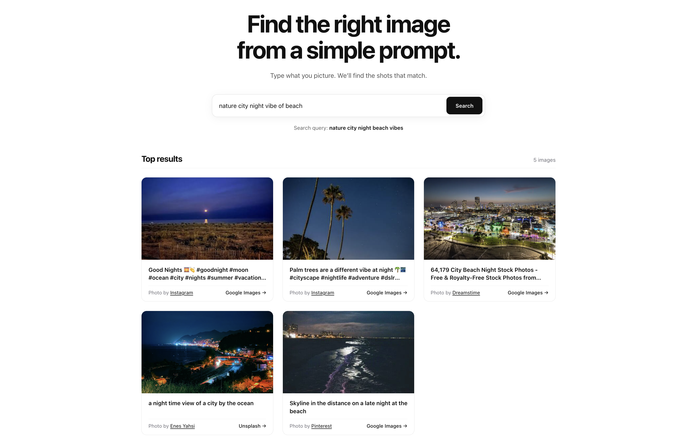
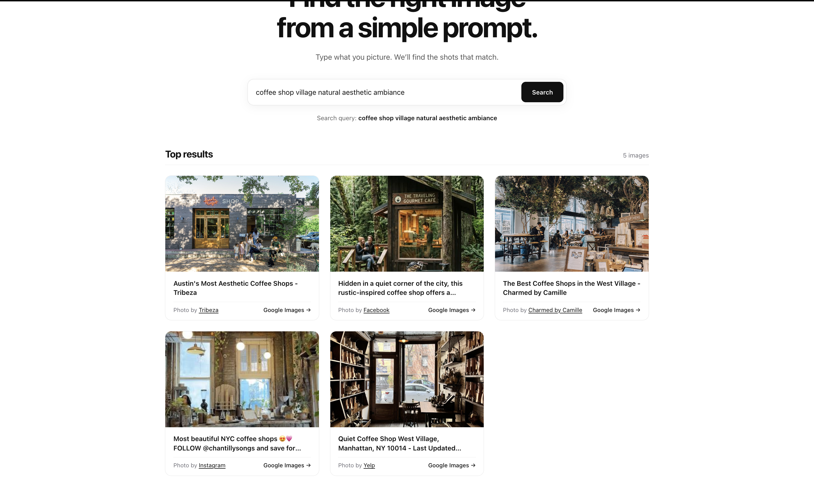

# AI Image Retrieval System

A full-stack application that retrieves and ranks the most relevant high-resolution images from natural language prompts using AI query reformulation, multi-source search (Unsplash & Google Images via SearchApi), and semantic ranking.

---
##  Preview





---

##  Architecture & Pipeline

```
 User Prompt
    │
    ▼
 LLM Query Reformulation (Claude 3.5 Haiku)
    │
    ├──────────────────────────┐
    ▼                          ▼
 Unsplash API             Google Images (SearchApi.io)
    │                          │
    └──────────┬───────────────┘
               ▼
   Candidate Images (~20)
               │
               ▼
   Semantic Token & Phrase Ranking
               │
               ▼
   Top 5 Ranked Results (or No Results Fallback)
               │
               ▼
   Minimalist React UI with Lightbox
```

---

##  Features

- **Natural Language Understanding**: Converts conversational prompts into concise, high-signal visual search queries using Claude.
- **Dual-Provider Parallel Retrieval**: Fetches image candidates concurrently from both **Unsplash** and **Google Images** (`SearchApi.io`) using `asyncio.gather`.
- **Relevance Ranking Engine**: Scores candidates based on normalized token matching, fuzzy similarity, and phrase matches to return the top 5 most relevant images.
- **"No Results" Fallback Handling**: Detects when retrieved images have 0% relevance and displays a user-friendly feedback state.
- **Hotlink & CDN Resilience**: Automatically utilizes Google CDN thumbnails for domains that block external referrers (e.g. Instagram/Facebook) to guarantee clean image rendering.
- **Minimalist White UI**: Clean, editorial-style interface with high contrast, responsive grid, source links, and an image inspection modal.

---

##  Tech Stack

- **Frontend**: React, Vite, Axios, Pure CSS (Minimalist design system)
- **Backend**: FastAPI, Uvicorn, HTTPX, Pydantic, Python-dotenv
- **AI & APIs**: Anthropic Claude API, Unsplash API, SearchApi.io

---

##  Getting Started

### 1. Clone the repository
```bash
git clone <your-repo-url>
cd image-retrieval
```

### 2. Backend Setup

```bash
cd backend

# Create and activate virtual environment
python3 -m venv .venv
source .venv/bin/activate

# Install dependencies
pip install -r requirements.txt

# Configure environment variables
cp .env.example .env
```

Open `.env` and fill in your API keys:
```env
UNSPLASH_ACCESS_KEY=your_unsplash_access_key
ANTHROPIC_API_KEY=your_anthropic_api_key
ANTHROPIC_MODEL=claude-haiku-4-5-20251001
SEARCHAPI_KEY=your_searchapi_key
```

Run the backend server:
```bash
uvicorn main:app --reload --host 127.0.0.1 --port 8000
```
The API will be available at `http://127.0.0.1:8000` (API docs at `http://127.0.0.1:8000/docs`).

---

### 3. Frontend Setup

In a new terminal window:
```bash
cd frontend

# Install dependencies
npm install

# Start the dev server
npm run dev
```
Open `http://localhost:5173` in your browser.

---

##  Testing

### Test Search
Enter any prompt such as:
- *"A red sports car on a mountain road"*
- *"Cozy coffee shop on a rainy afternoon"*
- *"Minimalist Scandinavian living room"*

### Test "No Results" Handling
Enter a non-existent or gibberish prompt (e.g. `xyznonexistentquantumobject99999`) to observe the graceful fallback message.
